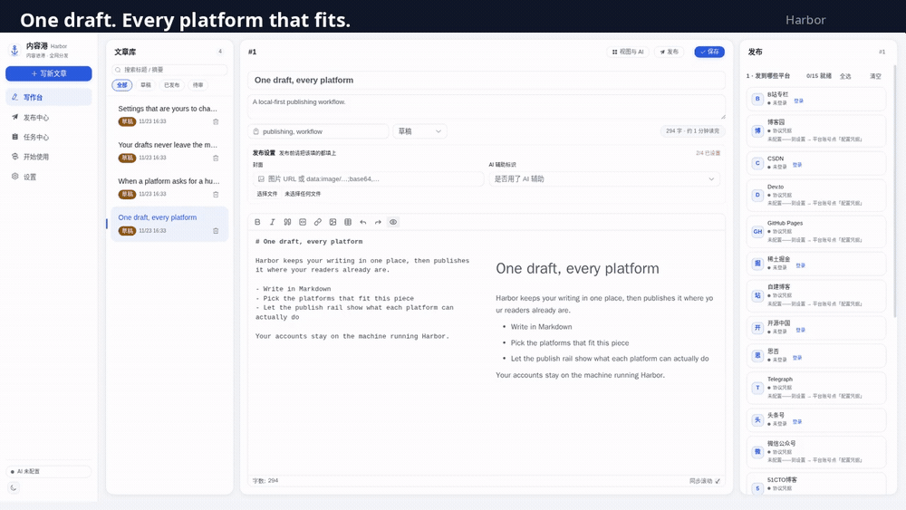
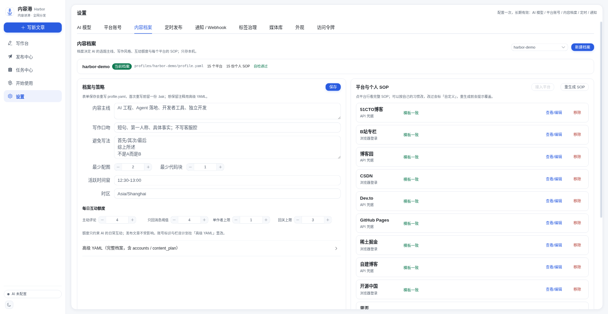
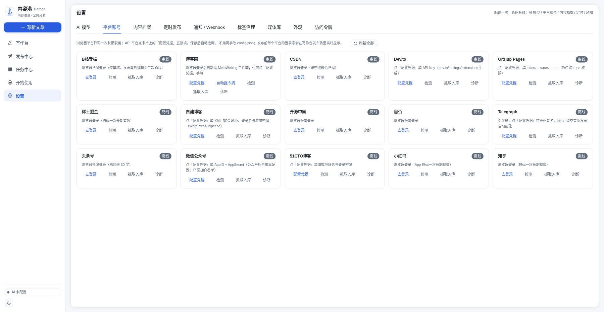

# Harbor 港

[English](README.md) · **简体中文**

一个自托管的发布中枢，给需要在多个地方写作的人用。
写一次，发到你已经在用的平台，已发布的副本保持同步。账号、草稿和发布记录都留在你自己的机器上。

[](https://github.com/badhope/harbor/actions/workflows/ci.yml)
[](LICENSE)



*动图演示；GIF 不播放时可直接看 [MP4](docs/screenshots/harbor-demo.mp4)。*

## 为什么用它

- **一次写作，多处发布。** 用 Markdown 写，挑适合这篇的平台，在同一个发布栏里看清每个平台到底能做什么。
- **改一次，处处更新。** 平台支持时，已发布的文章原地更新，不再重复发一遍。
- **平台卡住就停下。** 验证码、风控、登录失效时任务暂停并说明原因，处理完从停下的地方继续。
- **默认留在本地。** 账号、Cookie、草稿都在运行 Harbor 的机器上，没有云端账号，也没有遥测。
- **能按自己的习惯调。** 内容档案管写作方向、口吻、发布时间窗和互动额度；每个平台都有一份可看、可改、可恢复的 SOP。
- **AI 是选项，不是前提。** 想用 AI 写稿、审查或接 MCP 就用；不用也能完整发布。

## 界面



*内容档案：写作方向、口吻、额度、时间窗，以及每个平台自己的 SOP。*



*平台账号：需要扫码的平台走浏览器登录，走 API 的平台直接填凭据。*

## 快速开始

需要 Python 3.11+、[uv](https://docs.astral.sh/uv/)、Node 20+ 和 pnpm。

```bash
git clone https://github.com/badhope/harbor.git
cd harbor

# 终端 1：后端
cd backed
uv sync
uv run uvicorn app.factory:create_app --factory --host 127.0.0.1 --port 8000 --reload

# 终端 2：前端
cd web
pnpm install
pnpm dev            # http://127.0.0.1:5173
```

打开 <http://127.0.0.1:5173>，开发服务器会把 `/api` 转发到 8000。

第一次打开会走三步：建档案、接平台、复制 MCP 配置。同样的档案和 SOP 也能用命令行生成：

```bash
uv run --project backed python -m backed.cli init --name demo --platforms juejin,csdn
```

## 平台支持

适配器覆盖知乎、掘金、CSDN、B站、博客园、头条、开源中国、SegmentFault、51CTO、MetaWeblog 自建博客（WordPress/Typecho）、微信公众号、GitHub Pages、Dev.to、Telegraph、小红书。

需要浏览器登录的平台把会话存在本地档案里。走 API 的平台在「设置 → 平台账号 → 配置凭据」里填，密钥只写本机，界面只显示掩码。字段说明和命令行用法见 [PLATFORM_CONNECTION.md](PLATFORM_CONNECTION.md)。

> 登录发生在运行 Harbor 的机器上，不在 AI 客户端的浏览器里。MCP 客户端能查状态、能发布，但不能替你登录。

## 文档

从 [docs/README.md](docs/README.md) 开始。常用的几份：

- [登录与会话](docs/guides/login.md)
- [MCP 客户端](docs/guides/mcp-clients.md)
- [平台连接](PLATFORM_CONNECTION.md)
- [架构](docs/architecture/ARCHITECTURE.md)
- [路线图](docs/ROADMAP.md)
- [审计记录](docs/audit/AUDIT.md)
- [参与贡献](CONTRIBUTING.md) · [安全](SECURITY.md)

## 致谢

Harbor 建立在开源工作之上。用到的 MCP Server、库与工具见 [ACKNOWLEDGEMENTS.zh-CN.md](ACKNOWLEDGEMENTS.zh-CN.md)。

## 许可证

MIT，见 [LICENSE](LICENSE)。
